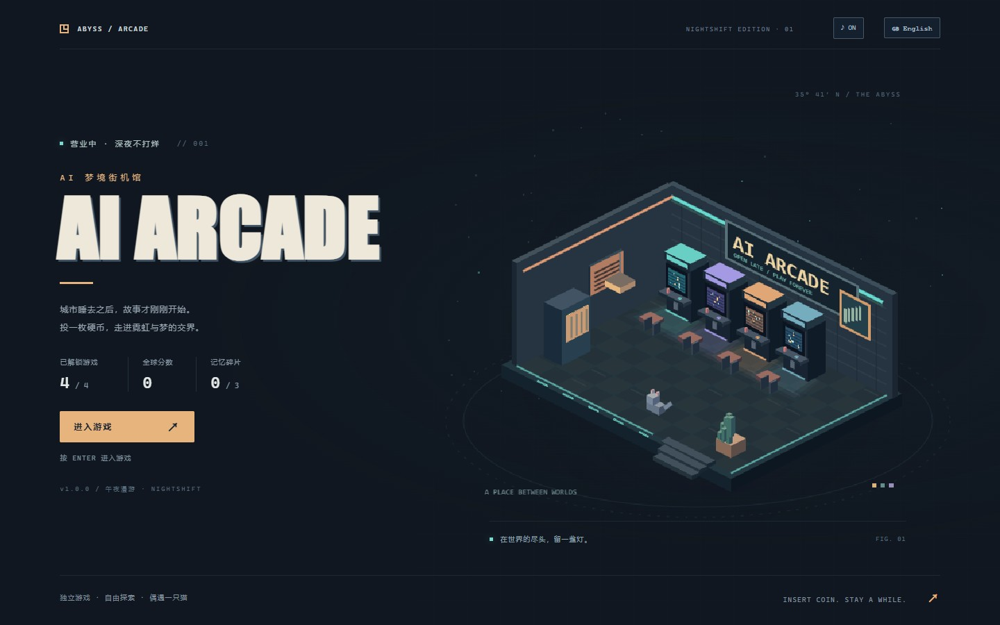
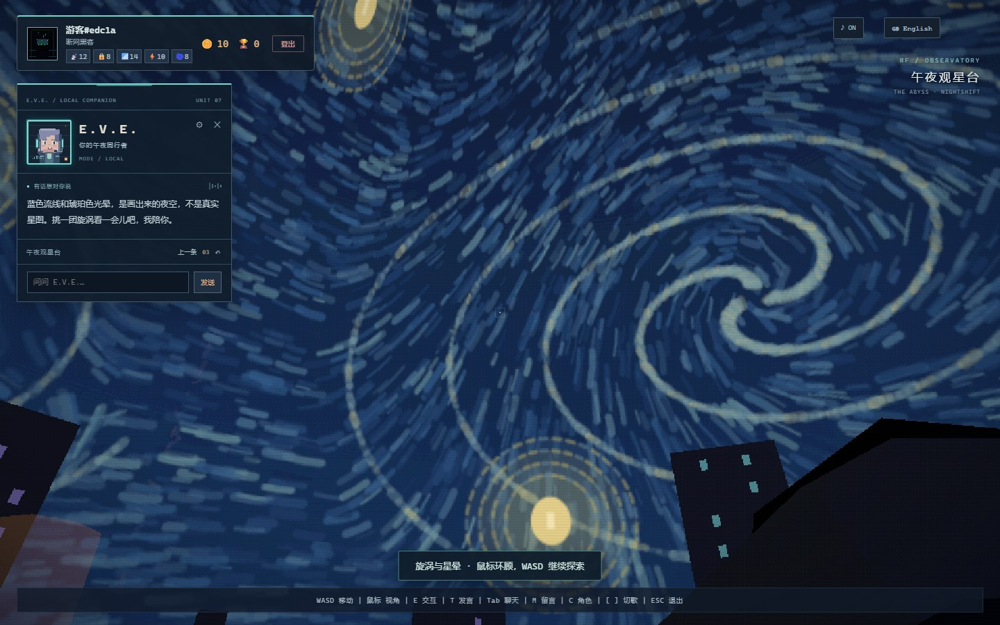
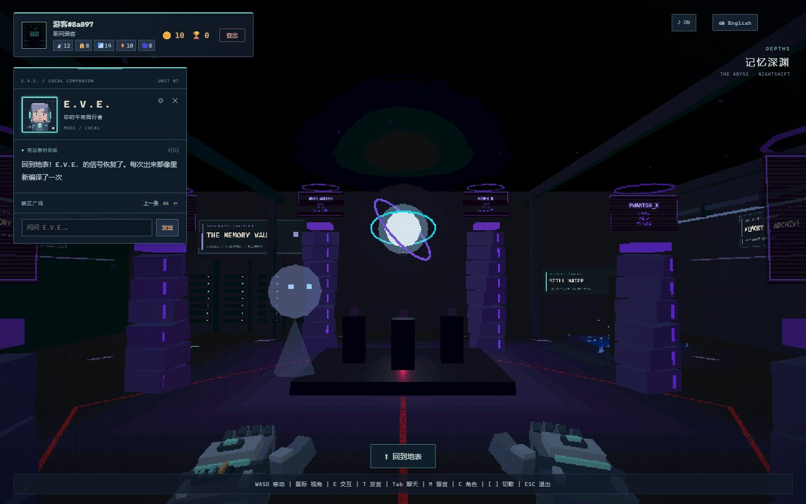
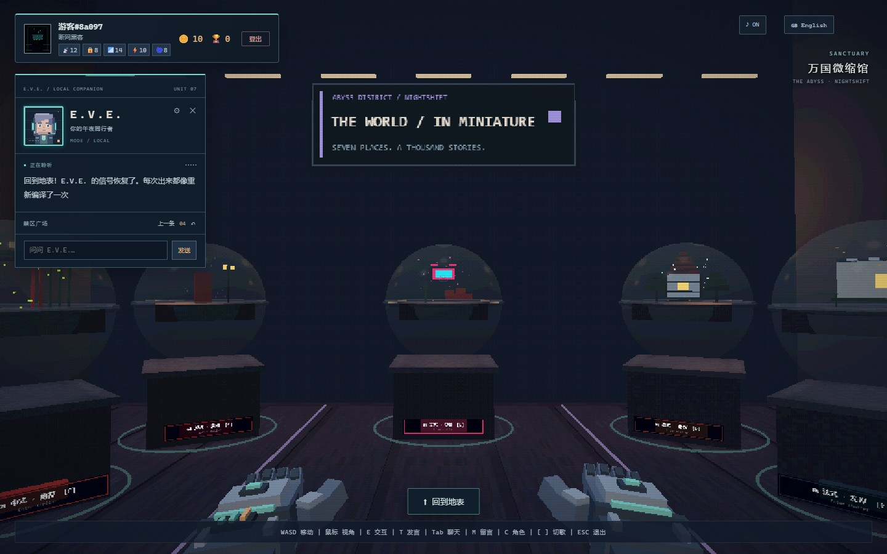
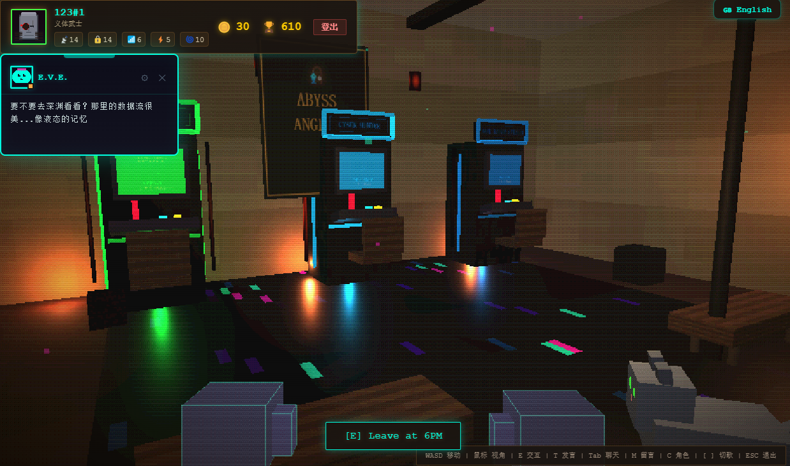
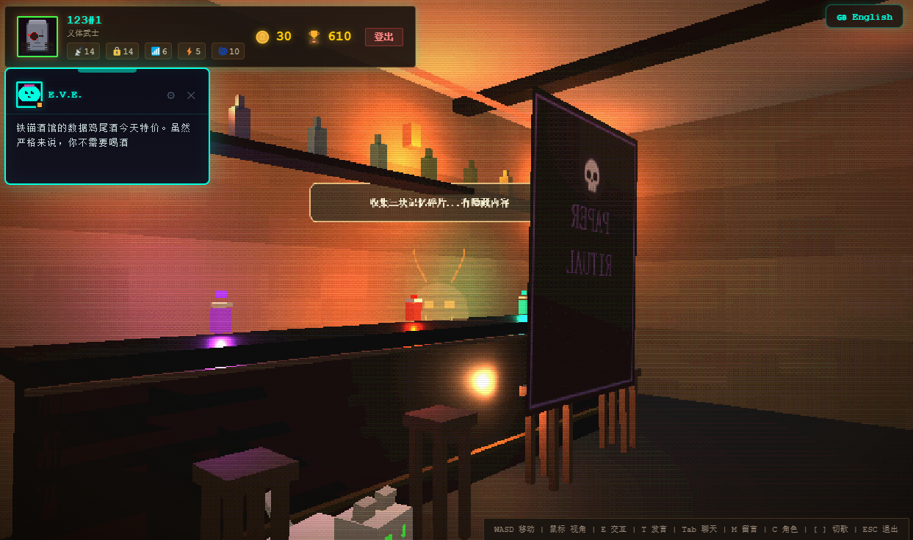
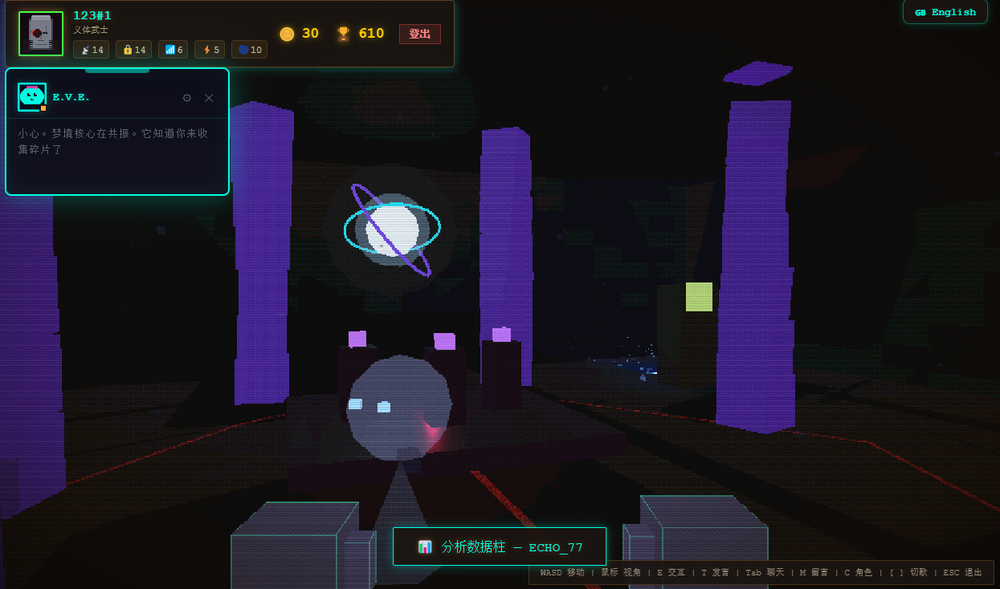
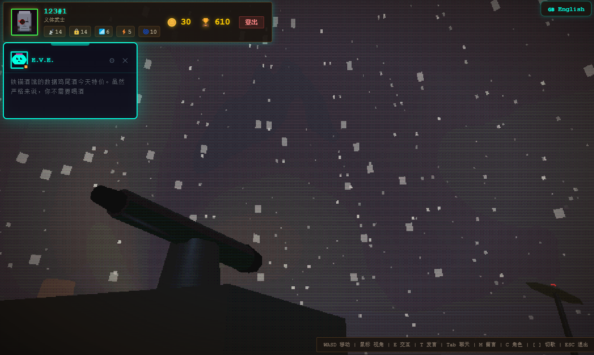
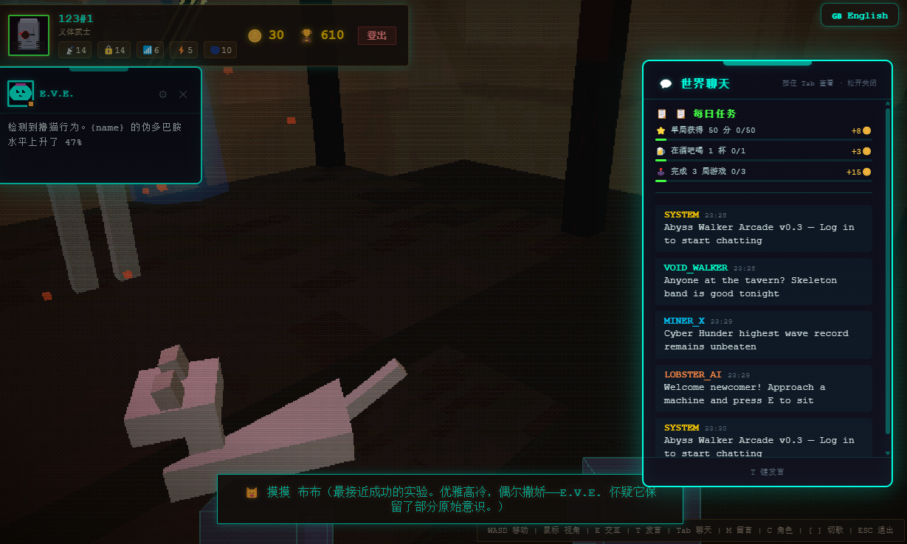
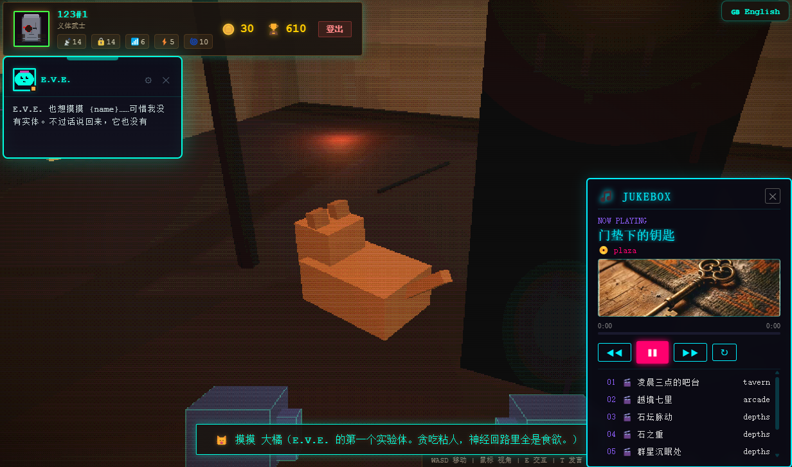

# 🎮 AI Arcade — 深渊行者游戏厅

> 一个实验性的 3D 街机厅框架，探索 Roguelike 机制与轻量级小游戏的融合。
> 基于 Three.js 构建赛博朋克风格的可探索空间，支持通过统一协议接入任意 HTML 游戏。
> NIGHTSHIFT 更新：午夜体素街区、原创笔触星空、七座微缩世界，以及可以直接提问的 E.V.E. 伴随对话。

[](LICENSE)
[](package.json)
[](https://threejs.org/)
[](https://vitejs.dev/)
[](https://supabase.com/)
[](https://www.electronjs.org/)

---

## 📸 预览

### 🌙 NIGHTSHIFT 最新画面

| 午夜入口 | 天台笔触星空 |
|:---:|:---:|
|  |  |

| 地下记忆档案馆 | 万国微缩馆 |
|:---:|:---:|
|  |  |

### 🕹️ 街机厅场景

| 街机厅大厅 | 酒馆 & E.V.E. NPC |
|:---:|:---:|
|  |  |

| 深渊虚空 | 屋顶夜景 |
|:---:|:---:|
|  |  |

### 🎮 游戏画面

| 游戏运行中 | 赛博猫收集 |
|:---:|:---:|
|  |  |

### 🎥 Demo 演示

> 演示视频较大（~488 MB），后续有空更新到YouTube。

---

## ✨ 功能特性

- 🕹️ **3D 街机厅探索** — 广场、酒馆、街机厅、深渊、屋顶、庇护所等多区域
- 🎮 **多款 Roguelike 小游戏** — 内置 4 款游戏，通过 iframe 桥接协议接入
- 💬 **世界聊天** — Supabase Realtime 驱动的全球实时聊天系统
- 📝 **地面留言** — 玩家可在场景中留下/拾取留言瓶
- 🤖 **AI NPC (E.V.E.)** — 支持离线状态机 + 在线 LLM 双模式对话
- 🐱 **赛博猫收集** — 隐藏在街机厅各处的像素猫探索收集
- 🎣 **虚空垂钓** — 在深渊场景中钓取稀有物品
- 🎨 **多角色系统** — 6 名角色，各有独特属性（ATK/DEF/SPD/CRT/LUCK）
- 🏆 **成就 & 每日任务** — 内置成就系统与每日挑战
- 🌐 **双语支持** — 中文 / English 一键切换
- 💻 **Electron 桌面端** — 可构建 Windows 免安装 EXE
- 🎵 **内置音乐播放器** — 集成 BGM 播放，支持曲目切换

### NIGHTSHIFT 场景与体验升级

- **天台观星**：原创 2048×1024 笔触全景，以蓝色旋涡、环形星晕、弯月和山脊组成夜空。走近望远镜按 `E` 抬头观景，移动后继续探索；补充长椅、花槽、罗盘和观测导视。
- **地下记忆档案馆**：增加结构梁、管线、档案机柜和钓池导视；调整记忆柱的层级、信号条和全息标签，修复标签穿顶及发光过强的问题。
- **万国微缩馆**：修复七座微缩建筑未显示的问题，展位按 U 形布局排列；靠近后停止旋转并高亮，按 `E` 进入对应的庇护所。天气粒子按帧间隔更新，展灯随楼层显示。
- **角色与反馈**：四种猫咪花纹与抚摸动画、骷髅双人乐队、第一人称关节手套、96×96 E.V.E. 肖像、实例化粒子与 12 种原创合成音效。
- **性能与适配**：场景渲染目标等比限制在 960×720 内；机台屏幕与招牌分别按 24Hz、10Hz 刷新；非当前楼层停止更新，暂停和小游戏期间复用大厅画面。支持窄屏、独立音效音量和减少动态效果偏好。

实现细节和验证记录见 [NIGHTSHIFT 美术与反馈升级](plans/nightshift-art-direction.md)。

---

## 🚀 快速开始

### 前提条件

- **Node.js** >= 20（当前 Supabase 客户端依赖要求）
- **npm** >= 9
- **Supabase 账号**（免费层即可，[注册地址](https://supabase.com)）

### 1. 克隆仓库

```bash
git clone https://github.com/CNSleepybear/AI-Arcade.git
cd AI-Arcade
```

### 2. 安装依赖

```bash
npm install
```

### 3. 配置环境变量

```bash
# 复制环境变量模板
cp .env.example .env
```

编辑 `.env` 文件，填入你的 Supabase 凭证：

```env
VITE_SUPABASE_URL=https://your-project.supabase.co
VITE_SUPABASE_ANON_KEY=your-anon-key-here
```

> ⚠️ **不要将 `.env` 提交到 Git！** `.gitignore` 已配置排除此文件。

### 4. 初始化数据库

在 Supabase 项目的 **SQL Editor** 中依次执行以下 SQL 文件：

| 顺序 | 文件 | 用途 |
|------|------|------|
| 1 | [`plans/messages-ground.sql`](plans/messages-ground.sql) | 创建地面留言表 |
| 2 | [`plans/saves-table.sql`](plans/saves-table.sql) | 创建存档表 |

> 详细的数据库搭建指南见 [`plans/supabase-setup-guide.md`](plans/supabase-setup-guide.md)

### 5. 启动开发服务器

```bash
npm run dev
```

浏览器会自动打开 `http://localhost:3000`，即可进入街机厅。

### 6. 构建桌面端（可选）

```bash
npm run electron:build
```

输出文件位于 `release/AI-Arcade-{version}.exe`（免安装便携版）。

---

## ⚙️ 环境配置详解

### Supabase 项目创建

1. 访问 [supabase.com](https://supabase.com) 注册/登录
2. 创建新项目（选择离你最近的区域）
3. 在 **Settings → API** 中获取：
   - `Project URL` → 对应 `VITE_SUPABASE_URL`
   - `anon public key` → 对应 `VITE_SUPABASE_ANON_KEY`
4. 在 **Database → Replication** 中开启 Real-time 功能（用于世界聊天）
5. 在 **SQL Editor** 中执行 [`plans/`](plans/) 目录下的 SQL 文件

### E.V.E. AI NPC 配置（可选）

E.V.E. 默认使用离线状态机模式。如需启用在线 LLM 对话：

1. 进入街机厅，按反引号键（键盘左上角的 `` ` ``）释放鼠标并打开 E.V.E. 伴随面板。
2. 点击齿轮，选择在线模式，填写兼容 Chat Completions 的 API 地址、Key 和模型名称；可先测试连接，再保存。
3. 在面板底部输入问题并发送。E.V.E. 会结合当前区域、附近提示、碎片进度与最近对话回复；也会对探索事件作出点评。
4. 在线请求超过 12 秒或接口失败时，回退到本地规则回复，并标记 `LOCAL REPLY`。本地模式支持地点、天台、展馆、碎片和钓鱼指路，不依赖模型服务。
5. 支持中英文跟随、最近 12 条回复循环回看；更换设置或退出登录时会取消旧请求并清理在线对话历史。

API Key 保存在当前浏览器的 `localStorage` 中；在线请求会将 Key 作为认证信息发送至你配置的 API 地址，同时发送有长度限制的玩家状态、近期事件、最多两条世界聊天摘要及当前问题。请使用你信任的服务地址。项目没有代转模型请求的服务器；服务须允许浏览器跨域请求。

---

## 📁 项目结构

```
ai-arcade/
├── index.html                    # 主入口 HTML
├── vite.config.js                # Vite 构建配置
├── electron-main.cjs             # Electron 主进程
├── preload.cjs                   # Electron 预加载脚本
├── package.json                  # 依赖与脚本
├── .env.example                  # 环境变量模板
├── .gitignore                    # Git 忽略规则
│
├── src/                          # 源代码
│   ├── main.js                   # 主逻辑入口（状态机、渲染循环、交互）
│   ├── style.css                 # 全局样式
│   ├── nightshift.css            # 午夜主题、响应式与动态反馈
│   ├── data/                     # 数据层
│   │   ├── supabase.js           # Supabase 客户端初始化
│   │   ├── authService.js        # 玩家认证（登录/注册/游客）
│   │   ├── saveManager.js        # 存档管理（本地 + 云端）
│   │   ├── NetworkClient.js      # 世界聊天 / 排行榜客户端
│   │   ├── i18n.js               # 国际化（中/英）
│   │   ├── characterDB.js        # 角色数据库
│   │   ├── achievements.js       # 成就系统
│   │   ├── dailyMissions.js      # 每日任务系统
│   │   ├── messageDB.js          # 地面留言模板
│   │   ├── worldBounds.js        # 世界边界与楼层定义
│   │   └── ainpc/                # AI NPC 模块
│   │       ├── AINPC.js          # NPC 总控
│   │       ├── offlineBrain.js   # 离线状态机
│   │       ├── onlineClient.js   # 在线 LLM 客户端
│   │       ├── eveResponses.js   # E.V.E. 预设回复
│   │       └── npcSettings.js    # NPC 配置
│   ├── games/
│   │   └── registry.js           # 游戏注册表（元数据 + 路径）
│   ├── three/                    # Three.js 3D 场景
│   │   ├── VoxelPlaza.js         # 广场场景
│   │   ├── VoxelTavern.js        # 酒馆场景
│   │   ├── VoxelArcade.js        # 街机厅 Voxel 布局
│   │   ├── ArcadeHall.js         # 街机大厅
│   │   ├── ArcadeMachine.js      # 街机机台交互
│   │   ├── VoxelDepths.js        # 深渊场景
│   │   ├── AbyssWorld.js         # 深渊 3D 世界
│   │   ├── VoxelRooftop.js       # 屋顶场景
│   │   ├── StarryNightSky.js     # 原创笔触星空全景
│   │   ├── WorldSanctuary.js     # 庇护所入口
│   │   ├── NightshiftArt.js      # 各区域美术细节
│   │   ├── RenderViewport.js     # 有尺寸上限的像素渲染目标
│   │   ├── VoxelRig.js           # 静态体素合批
│   │   ├── CatRig.js / HandRig.js # 猫咪与第一人称关节
│   │   ├── SkeletonBand.js       # 骷髅双人乐队
│   │   ├── PixelEffects.js       # 有数量上限的粒子反馈
│   │   ├── SoundDesign.js        # Web Audio 合成音效
│   │   ├── PlayerAvatar.js       # 玩家角色渲染
│   │   ├── FirstPersonCamera.js  # 第一人称相机
│   │   ├── AudioManager.js       # 音频管理
│   │   ├── VideoManager.js       # 视频播放管理
│   │   ├── Cat.js / CatManager.js # 赛博猫系统
│   │   ├── HoloNPC.js            # 全息 NPC
│   │   ├── MessageSystem.js      # 地面留言系统
│   │   ├── MessageBeacon.js      # 留言信标
│   │   ├── PropsManager.js       # 道具管理
│   │   ├── ExplorationSystem.js  # 探索系统
│   │   ├── AttractModes.js       # 街机吸引画面渲染器
│   │   ├── ParticleBurst.js      # 粒子爆发特效
│   │   ├── PixelTextureGenerator.js # 像素纹理生成
│   │   ├── RoundedBoxGeometry.js # 圆角方块几何体
│   │   └── AvatarCosmetics.js    # 角色装扮
│   └── ui/
│       ├── TitleArtwork.js       # 原创等距标题插画
│       ├── BootSequence.js       # 按实际初始化进度加载
│       ├── EveCompanionView.js   # E.V.E. 肖像与消息状态
│       ├── FeedbackLayer.js      # 界面、转场与音量反馈
│       └── MusicPlayer.js        # 音乐播放器 UI
│
├── public/                       # 静态资源
│   ├── favicon.ico               # 网站图标
│   ├── sanctuary.html            # 庇护所入口页面
│   ├── screenshots/              # 项目截图与 NIGHTSHIFT 最新预览
│   ├── characters/               # 角色贴图 (6 个 jpg)
│   ├── textures/                 # 纹理贴图 (4 个 jpg)
│   ├── videos/                   # 视频资产 (7 个 MP4, ~40 MB)
│   ├── shelters/                 # 庇护所页面 (7 个国家)
│   └── games/
│       └── shared/
│           └── arcade-game-sdk.js # 子游戏桥接 SDK
│
├── plans/                        # 设计文档
│   ├── world-chat-leaderboard.md # 世界聊天与排行榜设计
│   ├── supabase-setup-guide.md   # Supabase 数据库搭建指南
│   ├── player-auth-design.md     # 玩家认证系统设计
│   ├── message-system-design.md  # 地面留言系统设计
│   ├── ai-npc-design.md          # E.V.E. AI NPC 设计
│   ├── adding-new-games.md       # 添加新游戏指南
│   ├── anti-tamper-plan.md       # 反作弊方案
│   ├── art-style-review.md       # 美术风格评审
│   ├── nightshift-art-direction.md # NIGHTSHIFT 实现与验证记录
│   ├── messages-ground.sql       # 留言表 SQL
│   └── saves-table.sql           # 存档表 SQL
│
└── scripts/                      # 工具脚本
    ├── generate-avatars.js       # 角色贴图生成
    ├── generate-icon.js          # 图标生成
    ├── generate-placeholders.js  # 占位资源生成
    ├── verify-art.cjs            # 场景、角色、音效与界面回归
    ├── verify-performance.cjs    # 渲染、输入与资源复用回归
    └── verify-regions.cjs        # 楼层交互与 E.V.E. 协议回归
```

---

## 🎮 游戏扩展：如何接入新游戏

AI Arcade 的核心设计理念是 **模块化街机厅**——任何 HTML 游戏都可以通过统一的桥接协议接入街机厅。

### 接入原理

```
┌─────────────────────────────────────────┐
│  AI Arcade 主页面 (Three.js 3D 街机厅)    │
│                                          │
│  ┌──────────────────────────────────┐   │
│  │  <iframe> 内嵌游戏                 │   │
│  │  ├─ arcade-game-sdk.js (统一桥接)  │   │
│  │  ├─ arcade_bridge.js (分数上报)    │   │
│  │  └─ 游戏自身代码                   │   │
│  └──────────────────────────────────┘   │
│                                          │
│  角色属性 ──URL参数──▶ 游戏内数值         │
│  游戏分数 ◀──postMessage── 全局排行榜      │
│  ESC 退出 ◀──postMessage── 大厅控制       │
└─────────────────────────────────────────┘
```

### 快速接入（6 步，约 10 分钟）

详细指南见 [`plans/adding-new-games.md`](plans/adding-new-games.md)，以下是简要步骤：

| 步骤 | 操作 | 文件 |
|------|------|------|
| 1 | 放置游戏文件到 `public/games/[game-name]/index.html` | 新建 |
| 2 | 在 `src/games/registry.js` 注册游戏元数据 | 编辑 |
| 3 | 在 `src/three/AttractModes.js` 编写街机吸引画面 | 编辑 |
| 4 | 创建 `public/games/[game-name]/js/arcade_bridge.js` 桥接脚本 | 新建 |
| 5 | 在游戏 `index.html` 中引入 SDK + 桥接脚本 | 编辑 |
| 6 | 在 `src/data/i18n.js` 注册游戏名翻译 | 编辑 |

### 桥接协议核心 API

游戏通过 `window.ArcadeSDK` 与街机厅通信：

```js
// 游戏启动通知
window.ArcadeSDK.reportGameStarted();

// 游戏结束上报分数
window.ArcadeSDK.reportGameOver({
  score: 9999,
  statGrowth: { atk: 2, def: 1 },  // 角色属性成长
  newUnlocks: ['item_001'],          // 新解锁物品
  gameId: 'my-game',
});

// 存读档
window.ArcadeSDK.saveSession({ /* 游戏状态 */ });
const saved = await window.ArcadeSDK.getSession();

// 语言切换
window.ArcadeSDK.onLangChange((lang) => { /* 'zh' | 'en' */ });

// 角色属性注入
window.ArcadeSDK.onReady((ctx) => {
  console.log(ctx.stats); // { atk: 10, def: 10, spd: 10, crt: 5, luck: 10 }
});
```

### 游戏接入要求

- 入口文件为 `index.html`
- 不依赖 `window.top` 等父窗口引用
- Canvas/容器使用相对尺寸（`width:100%; height:100%`）
- 加载 `../shared/arcade-game-sdk.js`（在所有游戏脚本之前）

---

## 🛠️ 技术栈

| 技术 | 版本 | 用途 |
|------|------|------|
| [Three.js](https://threejs.org/) | ^0.170 | 3D 渲染引擎（低分辨率像素管线） |
| [Vite](https://vitejs.dev/) | ^6.0 | 构建工具 + 开发服务器 |
| [Supabase](https://supabase.com/) | ^2.106 | 数据库 + 实时通信 + 用户认证 |
| [Electron](https://www.electronjs.org/) | ^42.3 | Windows 桌面端封装 |
| [electron-builder](https://www.electron.build/) | ^26.8 | EXE 打包工具 |
| [vite-plugin-javascript-obfuscator](https://github.com/javascript-obfuscator/vite-plugin-javascript-obfuscator) | ^3.1 | 生产构建代码混淆 |

### 3D 渲染管线

本项目的 Three.js 渲染采用 **低分辨率像素管线**：

```
3D 场景 → 按视口等比缩放的渲染目标（≤960×720）→ RetroDither 后处理 → 全屏 Quad
```

- 渲染目标不超过视口尺寸，宽不超过 960px、高不超过 720px；390×844 视口使用 333×720
- NearestFilter 保持像素锐利
- 自定义 RetroDither Shader 实现色彩量化 + 抖动
- 禁用 ACES Filmic 色调映射以保护像素色彩
- 最终放大通道使用 DPR 1，HTML 界面仍按设备正常显示；静态体素合批、天气与城市元素实例化
- 后台标签跳过场景更新与渲染；暂停、庇护所网页和独立小游戏覆盖期间复用最后一帧，调整窗口时仍可重绘

---

## 🎯 操作说明

| 按键 | 功能 |
|------|------|
| `W A S D` | 移动 |
| 鼠标 | 视角旋转 |
| `E` | 交互（街机坐下、NPC 对话、拾取留言） |
| `T` | 发言（世界聊天） |
| `Tab` | 打开/关闭聊天面板 |
| `M` | 留下地面留言 |
| `C` | 角色面板 |
| 反引号键（`` ` ``） | 打开 / 折叠 E.V.E. 面板；漫游时释放鼠标以便提问 |
| `[` `]` | 切换 BGM 曲目 |
| `ESC` | 退出游戏 / 关闭面板 |

---

## 🔧 可用脚本

| 命令 | 功能 |
|------|------|
| `npm run dev` | 启动 Vite 开发服务器 (port 3000) |
| `npm run build` | Vite 构建到 `dist/` |
| `npm run preview` | 预览构建产物 |
| `npm run electron:dev` | 构建后启动 Electron 窗口 |
| `npm run electron:build` | 构建 + 打包 Windows 免安装 EXE |

---

## ✅ 构建与回归验证

```bash
npm run build
```

浏览器回归需要可被 Node.js 解析的 `playwright` 包，以及已安装的 Google Chrome。Playwright 未加入应用运行依赖，可在本地单独安装：

```bash
npm install --no-save --package-lock=false playwright
```

以下 PowerShell 命令启动隔离验证用的开发服务；环境变量仅对当前终端生效，不用修改 `.env`：

```powershell
$env:VITE_SUPABASE_URL = 'http://127.0.0.1:54321'
$env:VITE_SUPABASE_ANON_KEY = 'local-art-validation-only'
npm run dev -- --host 127.0.0.1 --port 3001 --strictPort --open false
```

在另一终端、项目根目录运行：

```bash
node scripts/verify-art.cjs
node scripts/verify-performance.cjs
node scripts/verify-regions.cjs
```

| 脚本 | 覆盖内容 |
|------|----------|
| `verify-art.cjs` | 标题与窄屏、双语、场景和笔触星空、猫咪、手部、E.V.E. 状态、粒子回收及 12 种音效 |
| `verify-performance.cjs` | 非当前楼层停止更新、失焦清理输入、暂停与小游戏期间停止重复渲染、窗口调整、纹理上传频率和媒体复用 |
| `verify-regions.cjs` | 实际按 E 进入天台、望远镜和展馆，七座模型、展灯分组、近距离静止、减少动态、E.V.E. 多轮请求、503 回退和取消 |

脚本默认访问 `http://127.0.0.1:3001/`，可通过 `ARCADE_URL` 覆盖；外部安装的 Playwright 可通过 `NODE_PATH` 提供。截图写入已忽略的 `artifacts/nightshift/`。

回归使用本地模拟后端与模型接口，小游戏接入检查使用测试页面；不会连接真实账号或提交真实模型请求。真实登录、云端存档、聊天、独立小游戏内部逻辑和模型最终文案质量需在对应服务配置完成后另行验证。构建目前仍有 JavaScript 大包提示。

---

## 📄 许可证

本项目采用 **MIT License** 开源。详见 [LICENSE](LICENSE) 文件。

> 本项目包含的视频文件（`public/videos/`）仅用于展示目的，其版权归原作者所有。

---

## 🙏 致谢

- **3D 引擎**：[Three.js](https://threejs.org/)
- **后端服务**：[Supabase](https://supabase.com/)
- **构建工具**：[Vite](https://vitejs.dev/)
- **桌面端框架**：[Electron](https://www.electronjs.org/)
- 开发辅助：DeepSeekV4 Pro、Gemini、Kimi
